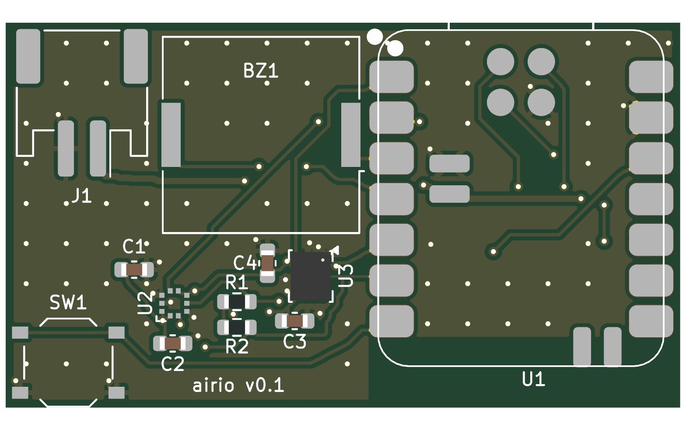

# airio

KiCad project for the airio carrier board: a Seeed XIAO nRF52840 soldered on
as a castellated module, with a BMP581 barometer, an LSM6DSV16X IMU, a piezo
beeper, a button, a 1S LiPo connector and SWD test pads. Signals follow the
pin map in [docs/airio-parts-and-pinmap.md](../../docs/airio-parts-and-pinmap.md).

Open `airio.kicad_pro` in KiCad 10. All files are saved in the KiCad 10
format. `airio.pdf` is a plot of the current schematic for reading without
KiCad.

| File | Contents |
|---|---|
| `airio.kicad_sch` | Schematic, one A4 sheet |
| `airio.kicad_pcb` | Two-layer board, 42 x 24 mm, 1.0 mm thick |
| `airio.kicad_dru` | Custom DRC rules (see PCB below) |
| `airio-top.png` | Render of the top side |
| `airio.kicad_sym` | Project symbols: XIAO nRF52840, BMP581, LSM6DSV16X |
| `airio.pretty/` | Project footprints: `XIAO-nRF52840-SMD`, `Bosch_LGA-10_2x2mm_P0.5mm` |
| `sym-lib-table`, `fp-lib-table` | Add the two project libraries as `airio` |
| `airio.pdf` | Schematic plot |

## ERC

ERC in KiCad 10.0.7 reports 0 errors and 2 warnings. Both warnings are
sensor address straps tied to a supply rail, which is intended:

- U2 (BMP581) SDO to +3V3 selects I2C address 0x47.
- U3 (LSM6DSV16X) SDO/SA0 to GND selects I2C address 0x6A.

Exclude them in the ERC window (right-click, Exclude) if you want a clean run.

## Footprints

- **U1** uses Seeed's `XIAO-nRF52840-SMD` footprint from
  [Seeed-Studio/OPL_Kicad_Library](https://github.com/Seeed-Studio/OPL_Kicad_Library)
  (commit 3be8215, CC-BY-SA-4.0). Pads 1-14 are the castellated edge, 15-18 the
  underside SWD pads (SWDIO, SWCLK, RST, GND), 19-20 the battery pads (BAT+,
  BAT-) and 21-22 NFC1/NFC2. The project symbol's underside pins were
  renumbered to Seeed's order so they land on the right pads.
- **U2** uses `Bosch_LGA-10_2x2mm_P0.5mm`: 10 pads at 0.5 mm pitch, two on the
  pin 1 side and three on each adjacent side, numbered counter-clockwise from
  the top. Pad centres sit 0.775 mm from the body centre, pads are 0.30 x
  0.325 mm. It was cross-checked against four open-source BMP581 footprints,
  since Bosch's datasheet PDF couldn't be read here. Check it against
  section 8 of the datasheet before ordering. The BMP580 uses the same package.

Every symbol pin has a matching footprint pad (checked with KiCad's pcbnew
Python against the netlist).

## PCB

- **Size:** 42 x 24 mm, two layers, 1.0 mm FR4. Everything sits on the top side
  for single-sided JLC assembly, apart from the six bare test pads.
- **Placement:** the XIAO sits on the right with its USB-C at the top edge. Its
  antenna end hangs over the bottom right, which has no copper on either layer
  (a rule area keeps tracks, vias and pours out). The piezo and JST sit along
  the top, the sensors in the lower middle, and the button in the bottom left.
  The BMP581 is kept away from the XIAO's regulator at the USB end.
- **Routing:** 0.2 mm signal tracks, 0.4 mm VBAT, 0.6/0.3 mm vias. Ground is
  poured on both layers and stitched with vias. One SCL track necks to
  0.15 mm between the LSM6DSV16X pads.
- **Test pads:** TP1-TP6 are on the bottom in a 2.54 mm row (GND, 3V3, SWDIO,
  SWCLK, RST, VBAT, left to right seen from the top), under the battery, for a pogo-pin SWD adapter.
- **DRC:** KiCad 10.0.7 with schematic parity finds 0 errors and 0 unconnected
  pads. The 25 warnings are silkscreen from the Seeed, switch and IMU
  footprints running over their own pads or the board edge, which JLC clips.
  `airio.kicad_dru` allows the 0.15 mm pad gaps of ST's LGA-14 land pattern,
  sets a 0.3 mm copper-to-edge clearance, and allows 0.15 mm tracks. All of
  these are within JLC's standard limits.

The layout was placed and routed by a script, not by hand, so it's worth a
look in KiCad before ordering.

## Parts

Prices are LCSC, converted at 1.3993 CAD per USD (Bank of Canada, 2026-10-23),
excluding shipping and duty. Stock was read from LCSC's product API on
2026-10-24. "Each" is the price at LCSC's smallest order quantity.

| Ref | Part | LCSC # | Qty | CAD each | Min order | LCSC stock |
|---|---|---|---|---|---|---|
| U1 | Seeed XIAO nRF52840 (102010448) | [C17209540](https://www.lcsc.com/product-detail/C17209540.html) | 1 | C$15.18 | 1 | 158 |
| U2 | Bosch BMP581 | [C5362283](https://www.lcsc.com/product-detail/C5362283.html) | 1 | C$3.59 | 1 | **0** |
| U2 alt | Bosch BMP580 | [C22391138](https://www.lcsc.com/product-detail/C22391138.html) | 1 | C$1.70 | 1 | 14,944 |
| U3 | ST LSM6DSV16XTR | [C5267406](https://www.lcsc.com/product-detail/C5267406.html) | 1 | C$4.75 | 1 | 6,395 |
| BZ1 | Murata PKLCS1212E4001-R1 | [C113159](https://www.lcsc.com/product-detail/C113159.html) | 1 | C$1.12 | 1 | 7,183 |
| J1 | JST S2B-PH-SM4-TB(LF)(SN) | [C295747](https://www.lcsc.com/product-detail/C295747.html) | 1 | C$0.31 | 5 | 27,250 |
| SW1 | XKB TS-1187A-B-A-B | [C318884](https://www.lcsc.com/product-detail/C318884.html) | 1 | C$0.03 | 20 | 923,940 |
| C1-C4 | Samsung CL10B104KO8NNNC, 100 nF 16 V X7R 0603 | [C66501](https://www.lcsc.com/product-detail/C66501.html) | 4 | C$0.013 | 50 | 796,150 |
| R1, R2 | UNI-ROYAL 0603WAF4701T5E, 4.7 kΩ 0603 | [C23162](https://www.lcsc.com/product-detail/C23162.html) | 2 | C$0.004 | 100 | 4,646,400 |

C1-C4 were changed from C1591 to C66501 because C1591 shows 0 stock at LCSC.
The BMP581 is out of stock at LCSC; the BMP580 fits the same footprint.

## Still to do before ordering

- Check J1's polarity against the LiPo you'll use. Pin 1 is VBAT. JST PH
  battery packs are not consistent about which side is red.
- Check the BMP581 footprint against section 8 of the datasheet.

To point the KiCad MCP server at this project, set
`KICAD_MCP_PROJECT_DIR=hardware/airio` or ask Claude to call `kicad_set_project`.
